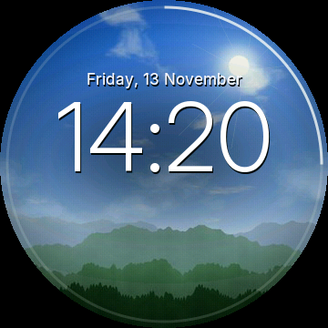
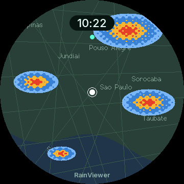
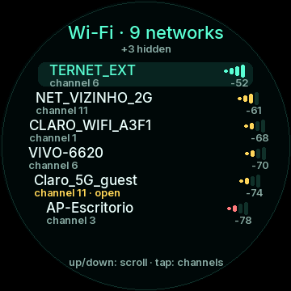
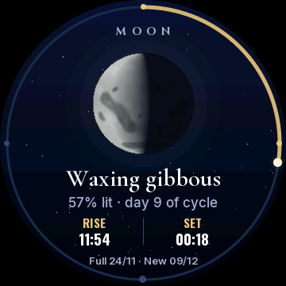
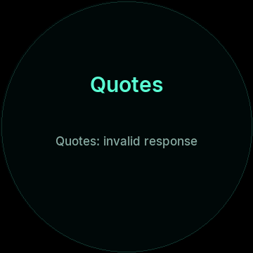
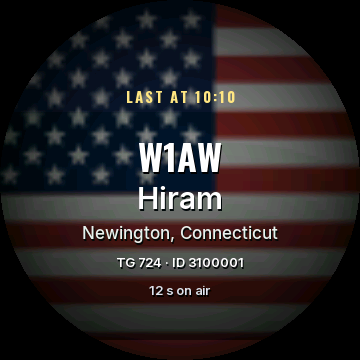
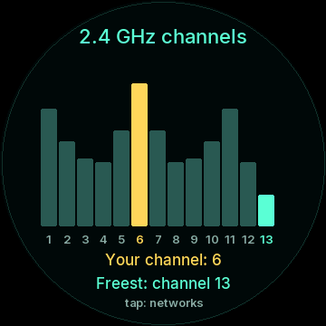

<div align="center">

# Radar360 · PV2KSM Firmware

**Open firmware for the GeekMagic "Radar 360" round display (ESP32-S3)**
A smart desk companion: live flight radar, animated rain radar, weather, news, currency quotes, moon phase, horoscope, PC monitor, DMR dashboard, Wi-Fi tools and more — all on a 360×360 round screen, configured from a password‑protected web panel, updated over the air.


  

</div>

> ⚠️ **Hobby project, no warranty.** This firmware is **not** official GeekMagic software. Flashing it the first time requires **soldering** and a **USB‑TTL (3.3 V) adapter**, and you do it **at your own risk** — see [Flashing guide](docs/HARDWARE.md). The authors are not responsible for bricked devices.

---

## Highlights (what you get beyond the stock firmware)

- **Live flight radar (ADS‑B)** — planes around you on a real map, with callsign, model, route and altitude; touch a plane for details. Center it on your city or any airport by ICAO code. Adjustable radius, plane size and color.
- **Animated rain radar** — RainViewer frames over a real basemap, with a temperature card and a "rain in 15 min" style alert.
- **Weather** — now, next hours and next days (Open‑Meteo), several visual styles.
- **News** — Google News by topic, or your own RSS/Atom feed; QR code to open a story on your phone; auto "breaking" banner.
- **Currency & crypto quotes** — up to 10 pairs (AwesomeAPI), rotating or as a board.
- **Moon** — real phase texture, % illuminated, rise/set and next full/new.
- **Horoscope** — a daily reading per sign with a real "Moon in …" calculation (just for fun).
- **PC monitor** — CPU/GPU/RAM/network from LibreHardwareMonitor, three styles.
- **DMR dashboard** — reads the "Last Heard" table from a Pi‑Star / WPSD hotspot on your LAN.
- **Wi‑Fi tools** — network scanner and 2.4 GHz channel analyzer; **network devices** (ARP scan: IP, name and vendor) on the device.
- **Photo frame** — upload photos from the web panel (cropped to 360 in the browser).
- **Clocks** — many analog and digital faces, realistic sky that follows the weather and time of day.
- **Three languages** — the whole interface (device **and** web panel) in **English, Português and Español**, switchable in the panel.
- **Password‑protected web panel + OTA** — configure everything from a browser; update firmware over the air after the first flash. A separate **recovery mode** can always re‑flash over the browser.

## Screens

| Clock | Rain radar | Moon | Horoscope |
|:--:|:--:|:--:|:--:|
|  |  |  |  |
| **Quotes** | **DMR** | **Wi‑Fi networks** | **Wi‑Fi channels** |
|  |  |  |  |

## Hardware

- **GeekMagic "Radar 360"** round display
- **ESP32‑S3‑N16R8** (16 MB flash, 8 MB PSRAM)
- **360×360 GC9B71** round LCD on a single‑lane SPI bus
- One button, USB‑C (power), 6‑pad UART header (P1) for the first flash

## Install

**First time: over a USB‑TTL cable (soldering required).** The USB‑C port is power‑only on this board, so the very first flash is done through the P1 pads with a 3.3 V USB‑TTL adapter. Full step‑by‑step, pinout notes and the **at‑your‑own‑risk** warning are in **[docs/HARDWARE.md](docs/HARDWARE.md)**.

**After that: over the air.** Once this firmware is running, open the web panel and go to **System → Updates** to flash new `*-ota.bin` builds — no more cables. If a bad flash ever bricks the normal firmware, the device falls back to **recovery mode** (hold the button ~5 s at power‑on) and shows an address where you can re‑flash from the browser.

## First run

1. On power‑up with no Wi‑Fi saved, the device starts a setup access point (its name shows on screen). Connect to it and open `192.168.4.1` (a QR code is shown too).
2. Add your Wi‑Fi network and set a panel password.
3. Reboot; the device joins your network. Its address (`radar.local`) shows on the **Network** screen.
4. Open the panel, pick your language, location and the screens you want.

## Web panel

Everything is configured from the browser: screens and their order, per‑screen styles and themes, location, flight radar, weather, news, quotes, PC, DMR, photos, brightness and night mode, time zone/NTP, and the **language** (English / Português / Español). The panel also exports/imports your settings and shows diagnostics.

## Build from source

The firmware is an Arduino‑ESP32 project. You need:

- **Arduino‑ESP32 core 3.3.x** (ESP32‑S3)
- Libraries: **LovyanGFX**, **ArduinoJson 7**, **AsyncTCP**, **ESPAsyncWebServer**
- Board: ESP32‑S3, 16 MB flash, QIO, with the custom partition table in `firmware/radar360/`

```bash
# regenerate the embedded web panel, then build
python3 tools/build_web.py
./build.sh            # see build.sh for the toolchain paths it expects
```

The build produces an OTA image (`build/radar360-vX.Y.Z-ota.bin`) you can upload from the panel. There is also a desktop **simulator** in `tools/sim/` that renders the screens without hardware (used to generate the screenshots above).

## Project layout

```
firmware/radar360/   ESP32-S3 firmware (Arduino/C++)
web/                 web panel (index.html) + /control PWA, embedded at build time
tools/build_web.py   gzips web/ into WebPage.h
tools/sim/           desktop simulator (renders the screens, no hardware)
docs/                manual, flashing guide and images
```

## Languages

The interface ships in **English (default), Português and Español**. Strings live inline as `T("en", "pt", "es")` (see `firmware/radar360/Lang.*`); the web panel translates itself from a dictionary and remembers the choice. Contributions for more languages are welcome.

## Credits

- Built for the **GeekMagic Radar 360** hardware (not affiliated with GeekMagic).
- Data: **adsb.fi / adsb.lol** (flights), **adsbdb.com** (routes), **RainViewer** (rain), **Open‑Meteo** (weather), **Google News** (news), **AwesomeAPI** (quotes), **RadioID.net** (DMR names), **OpenStreetMap / CARTO** (maps).
- Libraries: **LovyanGFX**, **ArduinoJson**, **AsyncTCP**, **ESPAsyncWebServer**, **NimBLE**.

## License

MIT — see [LICENSE](LICENSE). Do what you like, no warranty.
