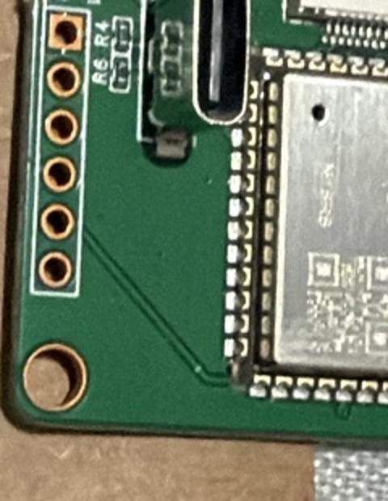
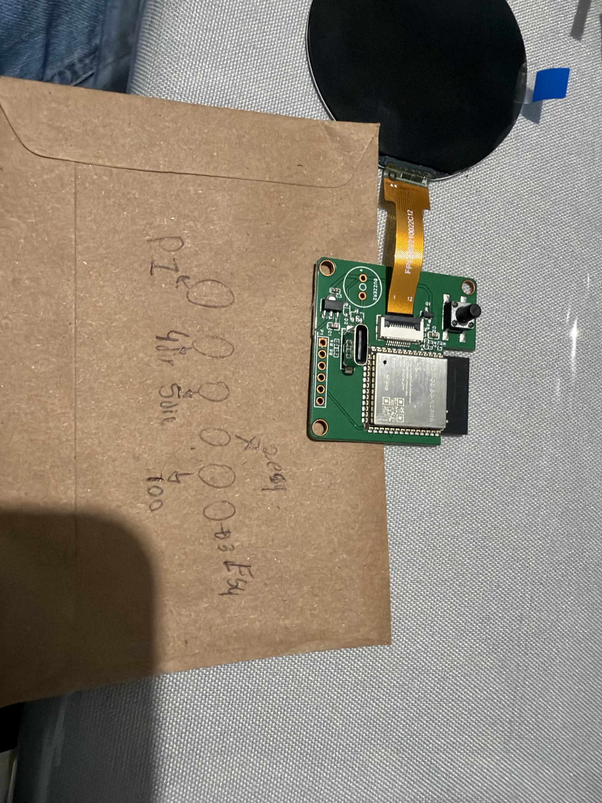

# Flashing guide — first install over USB‑TTL

> ## ⚠️ Read this first — at your own risk
> On this board the **USB‑C port is power‑only**, so the **first** flash of this firmware can only be done through the **P1 solder pads** with a **USB‑TTL serial adapter**. That means:
> - You must **solder** a header (or wires) to the P1 pads.
> - You must use a **3.3 V logic** USB‑TTL adapter. **Never use 5 V logic** — you can destroy the ESP32‑S3.
> - The exact function of each P1 pad is **not printed** on the board. **Verify every pad with a multimeter before connecting anything** (see below). Connecting power or TX/RX to the wrong pad can **permanently damage** the device.
> - **The pad order/pinout varies between board versions and revisions.** The photos below are only a reference for one unit — **do not trust any photo or table for your board.** Always map the pads on *your* revision with a multimeter.
> - **You do this entirely at your own risk.** This is an unofficial hobby firmware; the authors take **no responsibility** for damaged hardware.
>
> After the first successful flash, **all future updates are over‑the‑air** from the web panel — no more soldering.

---

## What you need

- A **USB‑TTL adapter set to 3.3 V** (CP2102, CH340, FT232 — with a 3.3 V/5 V jumper set to **3.3 V**).
- A **soldering iron**, thin wire or a 6‑pin header.
- A **multimeter** (continuity/beep mode) to identify the pads.
- `esptool` (`pip install esptool`) on your computer.
- The firmware files from a release: the full `*.factory.bin` (or the three bootloader/partition/app images).

## The P1 header

The programming header is the **6‑pad column marked `P1`** near the USB‑C connector and the ESP32‑S3 module. **Pad 1 is the square pad** (the others are round).





> ⚠️ **These photos show one specific board and are a reference only.** The pad layout **changes from version to version** — the pads may be in a different order, or in a different place, on your unit. Treat the images as "what P1 looks like," never as the pinout for your board. The table below lists the signals you need to find; **which physical pad is which is for you to confirm with a multimeter** on your own revision.

A standard ESP32‑S3 UART download needs just four signals:

| Signal | Goes to | Notes |
|---|---|---|
| **GND** | adapter GND | common ground — identify first |
| **3V3** | adapter 3V3 (optional) | you can also power the board from USB‑C instead |
| **TXD** (board → PC) | adapter **RXD** | board transmit |
| **RXD** (board ← PC) | adapter **TXD** | board receive |
| **IO0 / BOOT** | GND while resetting | to enter download mode |

> The order of the pads on P1 is **not labeled**, so do not assume it. Use the checks below to map each one **before** you solder/connect.

## Identify each pad with a multimeter (do this first)

With the board **unpowered**, in continuity mode:

1. **GND** — beeps against the metal shield of the ESP32‑S3 module or any large ground plane / mounting hole.
2. **3V3** — beeps against the module's 3V3 pin / the output of the on‑board regulator (not against GND).
3. **IO0 / BOOT** — often has a pull‑up; it should **not** beep to GND or 3V3 directly.
4. **TXD / RXD** — the two remaining signal pads. If you can't tell them apart, it is safe to **try one way, and if the flash doesn't start, swap TXD/RXD** — swapping these two does not damage anything.

If you are unsure about any pad, **stop** and find the GeekMagic schematic/pinout for your exact board revision. Guessing on the power pads can fry the board.

## Enter download mode and flash

1. Solder wires to **GND, TXD, RXD** (and **3V3** if you are not powering from USB‑C).
2. Wire the board to the adapter: **GND↔GND**, board **TXD↔adapter RXD**, board **RXD↔adapter TXD**. Double‑check the adapter is on **3.3 V**.
3. Power the board: plug the **USB‑C** (power) *or* feed **3V3** from the adapter — **not both**.
4. **Enter download mode:** hold **IO0/BOOT to GND**, briefly remove power (or pulse reset/EN), then release IO0. The ESP32‑S3 is now waiting for a flash. (Some units enter download mode automatically with esptool's `--before default_reset`.)
5. Flash with esptool, e.g. a full factory image:

   ```bash
   esptool.py --chip esp32s3 --port /dev/ttyUSB0 --baud 460800 \
     write_flash 0x0 radar360-vX.Y.Z.factory.bin
   ```

   (On Windows the port is like `COM5`. Lower the baud to `115200` if it fails.)
6. When it finishes, remove the IO0↔GND jumper and power‑cycle. The round screen should light up.

## After the first flash

- On first boot with no Wi‑Fi, the device opens a **setup access point** (its name is shown on screen, with a QR code). Connect, open `192.168.4.1`, add your Wi‑Fi and set a panel password.
- From then on, update firmware **over the air**: web panel → **System → Updates** → upload a `radar360-*-ota.bin`. No cables, no soldering.
- If an update ever bricks the normal firmware, hold the button for **~5 s at power‑on** to enter **recovery mode**, which shows an address where you can re‑flash from the browser.

---

*Again: identifying the pads and flashing is done entirely at your own risk. When in doubt, verify with a multimeter and the official board documentation before connecting power.*
